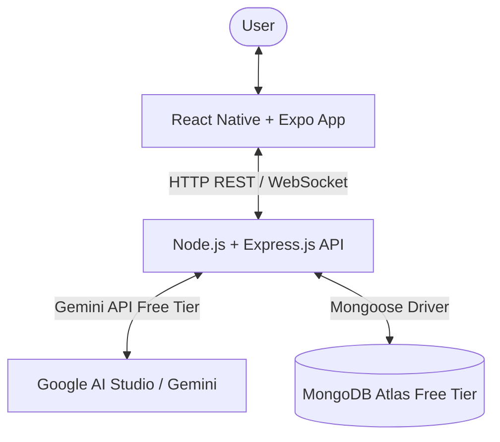

# Personal AI Assistant - Project Architecture & Roadmap

This document outlines the architecture, directory structure, security design, and incremental roadmap for the Personal AI Assistant mobile application.

---

## 1. High-Level System Architecture



### Core Architectural Principles
1. **Zero Client Secrets**: The mobile application contains **no** API keys or database connection strings. All external services (Google Gemini API, MongoDB Atlas) are accessed strictly by the backend server.
2. **Cost Constraint**: Built entirely using **free-tier** services with no paid upgrades or billing requirements.
3. **Clean Separation of Concerns**:
   - `mobile/`: Handles UI presentation, speech recognition triggers, audio playback, client notifications, and user interactions.
   - `backend/`: Handles prompt engineering, conversation memory persistence, AI response generation, business logic, and scheduling triggers.
   - `docs/`: Holds architectural diagrams, setup guides, and milestone logs.

---

## 2. Directory Structure

```text
personal-ai-assistant/
├── .gitignore                    # Root gitignore (protects secrets, node_modules, build artifacts)
├── README.md                     # Project overview and quick start instructions
├── docs/                         # Architecture, guides, and learning notes
│   └── architecture.md
├── mobile/                       # React Native (Expo) Mobile Application
│   ├── assets/                   # App icons, splash screens, custom fonts/audio
│   ├── src/                      # Mobile source code (introduced as features grow)
│   │   ├── components/           # Reusable UI components
│   │   ├── screens/              # App screens (Chat, Memories, Settings, Tasks)
│   │   ├── services/             # API client services (calls to Express backend)
│   │   └── hooks/                # Custom React hooks (voice, notifications)
│   ├── App.js                    # Root mobile application component
│   ├── app.json                  # Expo configuration
│   └── package.json              # Mobile dependencies & scripts
└── backend/                      # Node.js + Express API Server
    ├── .env                      # Local environment variables (IGNORED BY GIT)
    ├── .env.example              # Template for environment variables
    ├── server.js                 # Express server entry point & route definitions
    ├── src/                      # Backend source modules (introduced in future milestones)
    │   ├── config/               # Database & AI client configuration
    │   ├── controllers/          # Route controller handlers
    │   ├── models/               # MongoDB Mongoose schemas (Memories, Conversations, Tasks)
    │   └── routes/               # API route definitions
    └── package.json              # Backend dependencies & scripts
```

---

## 3. Technology Stack & Free-Tier Services

| Layer | Technology | Free-Tier Details |
|---|---|---|
| **Mobile App** | React Native + Expo | Free & Open Source |
| **Backend** | Node.js + Express.js | Self-hosted locally / free hosting (e.g. Render/Railway free tier) |
| **AI Engine** | Google Gemini API | Free tier via Google AI Studio (`gemini-1.5-flash` / `gemini-2.0-flash`) |
| **Database** | MongoDB Atlas | M0 Free Cluster (512MB storage, shared RAM, free forever) |
| **Voice & Speech** | Expo Speech / Web Speech API | Native device text-to-speech and speech-to-text (free, on-device) |
| **Notifications**| `expo-notifications` | Local scheduled notifications (free, no push server needed initially) |

---

## 4. Development Milestones

- [x] **Milestone 1**: Project initialization, directory structure, environment configuration, root gitignore, and verification of both Mobile & Backend skeletons.
- [ ] **Milestone 2**: Database setup & connection (MongoDB Atlas M0 Free Cluster, Mongoose schema for persistent user memory).
- [ ] **Milestone 3**: Gemini AI integration on the backend (Free API key, prompt engineering, context injection with memory).
- [ ] **Milestone 4**: Mobile UI connection to backend (Chat interface, message history, live backend health status).
- [ ] **Milestone 5**: Voice input (Speech-to-Text) and spoken responses (Text-to-Speech) using free on-device capabilities.
- [ ] **Milestone 6**: Task management and local scheduled notifications for reminders and deadlines.
